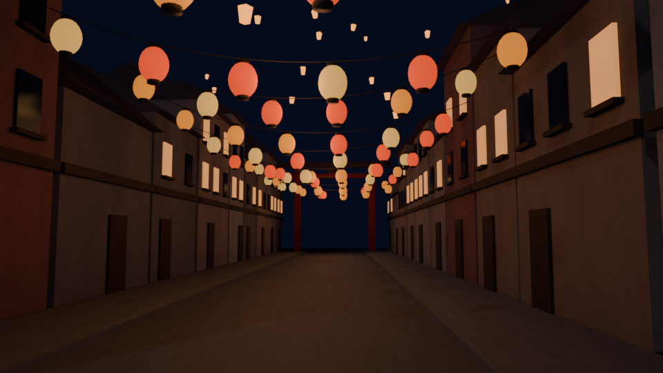

# Lantern Game

## Play the village

Walk from the market across the river to the temple and the thatched home marked on the village map. The north-up map tracks the boy’s position and heading. Market, Minka and Golden hour set the starting view and lighting for the same valley.

Use W/S to walk, A/D to turn, and Shift to run. On touch screens, drag up or down and hold to walk, or drag sideways to turn. At the fruit counter, press E or tap the purchase button. A mandarin costs 3 mon, and your purse and fruit count update with each purchase.

From `web`, run `npm ci` and `npm run build`. Open `dist/index.html` in a WebGL-capable browser. The build embeds the boy, fonts and Three.js.

## Scene 1: Festival Street

A semi-realistic night street in a lantern festival town, built in Blender 5.2.

| File | What it is |
|---|---|
| `blender/festival_street.blend` | Source scene (collections: Environment, Buildings, Lanterns, Lighting, Props) |
| `exports/festival_street.glb` | Game-ready export with lights and camera |
| `renders/festival_street_preview.png` | Preview render from the main camera |

**Scene contents:** a 60 m cobblestone street with sidewalks, 20 gabled houses with lit and dark windows,
11 rope strings of red/orange/gold paper lanterns (shared meshes, one warm point light per string),
45 floating sky lanterns, and a red lacquer festival gate at the far end.

**Street props:** 7 market stalls with awnings, produce baskets and a small lamp; crates (some stacked), barrels and burlap sacks;
potted and tall plants beside doorways; and red, gold and indigo shop banners hanging from the facades.
Props share meshes, so each prop type is exported once and reused.

**Notes:** lanterns and windows are emissive materials; enable bloom in your game engine for the glow.

## Scene 2: Lantern River (work in progress)

`blender/lantern_river.blend` holds the LanternRiver scene: terrain, a river, a wooden bridge with hanging
lanterns, and a riverside house with a porch and glowing paper windows. It has no camera or world yet.
