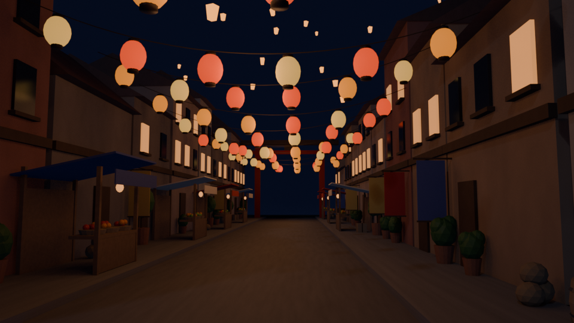

# Lantern Game

## Scene 1: Festival Street

A semi-realistic night street in a lantern festival town, built in Blender 5.2.

| File | What it is |
|---|---|
| `blender/festival_street.blend` | Source scene (collections: Environment, Buildings, Lanterns, Lighting, Props) |
| `exports/festival_street.glb` | Game-ready export with lights and camera |
| `renders/festival_street_preview.png` | Preview render from the main camera |

**Scene contents:** a 60 m cobblestone street with sidewalks, 20 gabled houses with lit and dark windows,
11 rope strings of red/orange/gold paper lanterns (shared meshes, one warm point light per string),
45 floating sky lanterns, and a red lacquer festival gate at the far end.

**Street props:** 7 market stalls with awnings, produce baskets and a small lamp; crates (some stacked), barrels and burlap sacks;
potted and tall plants beside doorways; and red, gold and indigo shop banners hanging from the facades.
Props share meshes, so each prop type is exported once and reused.

**Notes:** lanterns and windows are emissive materials; enable bloom in your game engine for the glow.
